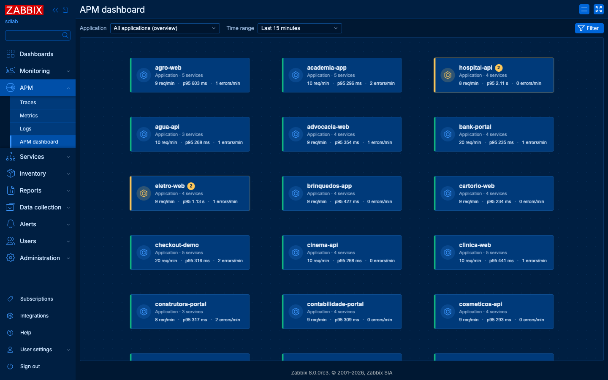
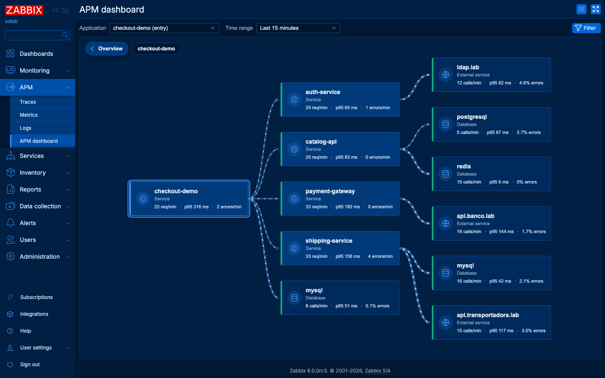

# APM dashboard para o Zabbix 8.0

Mapa de serviços estilo New Relic **dentro do frontend do Zabbix 8.0**, em **APM → APM dashboard**, montado sozinho a partir dos traces do APM.

É um módulo de frontend oficial, do mesmo tipo dos que aparecem em *Administration → General → Modules*: não altera nenhum arquivo do Zabbix, não cria tabelas, não reinicia serviços e usa a sessão e as permissões do usuário logado. Instala com um comando e desinstala com outro.



## O que ele mostra

- **Fluxo automático.** Lê os spans recentes (`apmspan.get`) e descobre quem chama quem. Bancos de dados (`db.system`) e serviços externos (`server.address`) viram nós próprios.
- **Incidentes do Zabbix no mapa.** Cada serviço é ligado ao host do Zabbix com o mesmo nome do `service.name`. Triggers em problema pintam o serviço e as ligações que chegam nele: verde OK, amarelo atenção/média, vermelho alta/desastre.
- **Detalhe ao passar o mouse.** Num serviço: itens do Zabbix com gráfico dos últimos 30 minutos, problemas abertos, endpoints e os traces com erro ou mais lentos. Numa ligação: chamadas por minuto, p95, média, erros, operações e traces. Cada trace abre em APM → Traces.
- **Visão geral por aplicação.** Cada serviço que ninguém chama é a entrada de uma aplicação. A visão geral mostra um card por aplicação com o pior estado dela; clicar abre o fluxo.
- **Memória de 7 dias.** Serviços e ligações já vistos continuam no mapa mesmo sem tráfego, tracejados.
- **Filtro por atributos.** O mesmo filtro de APM → Traces (atributos de recurso e de span, Exists/Equals/Contains e negações, And/Or ou Or), guardado no perfil do usuário.
- **Modo de edição** (Admin e Super admin), igual ao do dashboard do Zabbix: menu de ações → Edit. Arraste os cards para reorganizar a grade e clique em Save; o X no canto de cada aplicação ou serviço o tira do mapa (ele volta sozinho se aparecer de novo nos traces).
- **Tema e idioma do usuário.** Segue o tema do Zabbix (Blue, Dark, Dark blue, alto contraste…) e o idioma do perfil, com tradução para os mesmos 39 idiomas do Zabbix 8.0.
- **Kiosk mode**, como nos dashboards.




Atualiza a cada 30 segundos. A coleta é compartilhada: não importa quantas pessoas estejam olhando, o Zabbix é consultado no máximo uma vez a cada 30 segundos por janela de tempo.

## Requisitos

- Zabbix **8.0** (frontend) com o APM configurado: fonte de dados global apontando para o ClickHouse e aplicações enviando traces para um proxy com o coletor APM.
- Para as cores de incidente, hosts com o **mesmo nome técnico** do `service.name` e os itens `apm.requests`, `apm.latency.p95`, `apm.errors` e `apm.logs.error` (dependentes dos itens *Telemetry query*). Sem o host, o serviço aparece cinza ("No Zabbix host").
- Para o mapa aparecer em outro idioma, o locale correspondente precisa existir no servidor, como para o próprio Zabbix.

## Instalar

No servidor do frontend, como root:

```bash
curl -fsSL https://raw.githubusercontent.com/daniel-nasiloski-wct/zabbix-service-flow/main/install.sh | sh
```

Depois, no frontend como Super admin: **Administration → General → Modules → Scan directory** e habilite **APM dashboard**. O item aparece em **APM → APM dashboard**.

O script só cria `<frontend>/modules/zabbix_service_dashboard/` (arquivos `root:root`, 644/755). Ele detecta o diretório do frontend (`/usr/share/zabbix/ui` nos pacotes oficiais de RHEL, Alma, Rocky, Oracle, CentOS Stream, Amazon Linux, Debian, Ubuntu, Raspberry Pi OS e SUSE, ou o `Alias`/`root` da configuração do Apache/Nginx) e recusa versões anteriores à 8.0. Precisa só de `curl` e `tar`.

Para registrar e habilitar o módulo no mesmo comando, sem passar pelo *Scan directory*, informe a API e um token de um Super admin:

```bash
ZABBIX_URL=https://zabbix.exemplo.com/zabbix/api_jsonrpc.php ZABBIX_TOKEN=... \
  sh -c "$(curl -fsSL https://raw.githubusercontent.com/daniel-nasiloski-wct/zabbix-service-flow/main/install.sh)"
```

Outras opções:

```bash
sh install.sh status                     # versão instalada
sh install.sh uninstall                  # remove o diretório (depois: Scan directory no frontend)
sh install.sh --ref v1.0.0               # uma tag ou branch específica
sh install.sh --archive ./pacote.tar.gz  # a partir de um arquivo local (sem internet)
ZABBIX_FRONTEND_DIR=/caminho sh install.sh   # quando a detecção falhar
```

Rodar de novo atualiza no lugar. Para esconder o mapa de alguns perfis: *Users → User roles → Access to modules*.

## O que o módulo toca (e o que não toca)

| | |
| --- | --- |
| **Toca** | O diretório do módulo e, depois de habilitado, a coluna `config` da própria linha na tabela `module` (onde o Zabbix guarda a configuração de cada módulo). É lá que ficam a memória de topologia (7 dias, compacta, teto de 60 KB), as remoções manuais e a ordem dos cards. |
| **Não toca** | Arquivos do frontend, `zabbix.conf.php`, Apache/Nginx/php-fpm, schema do banco, hosts, itens, triggers, dashboards. Nenhum serviço é reiniciado. O servidor Zabbix (daemon) nem sabe que o módulo existe: tudo roda no PHP do frontend. |
| **Lê** | `apmspan.get`, `host.get`, `item.get`, `history.get` e `trigger.get` pela API interna, com as permissões do usuário. Um usuário comum vê só os serviços cujos hosts e atributos de recurso ele pode ver. |
| **Cache** | 30 segundos, em arquivos no diretório temporário do PHP. Perder o diretório custa só uma coleta a mais. |
| **Reverter** | *Administration → General → Modules → Disable* (imediato) e `sh install.sh uninstall`. |

## Como funciona

1. A página (`servicedashboard.view`) entrega o HTML com o filtro do Zabbix, os controles do cabeçalho e o ponto de montagem; o mapa em si é um bundle React carregado só nessa página.
2. A ação de dados (`servicedashboard.data`) coleta spans, hosts, itens, histórico e triggers com a sessão do usuário, monta o grafo em PHP (`includes/CGraph.php`, o mesmo algoritmo de `src/graph.js`, com teste de paridade) e devolve JSON. O resultado fica em cache por 30 segundos.
3. O navegador aplica estado, layout e animações, e consulta de novo a cada 30 segundos.
4. Remoções (`servicedashboard.remove`) e a ordem dos cards (`servicedashboard.layout`) são POSTs com token CSRF, permitidos a Admin e Super admin, gravados na linha do módulo.

As traduções usam gettext com domínio próprio (`locale/<idioma>/LC_MESSAGES/zabbix_service_dashboard.mo`), no idioma que o usuário escolheu no Zabbix.

## Desenvolvimento

Requer Node 22+ para compilar o frontend (o servidor do Zabbix não precisa de Node: o bundle vai commitado em `zabbix_service_dashboard/assets/`).

```bash
npm install
npm run dev          # harness em http://localhost:8000 que imita a página do Zabbix (dev/fixture.json, troca de tema)
npm run build        # gera assets/js/service-dashboard.js e assets/css/service-dashboard.css dentro do módulo
npm run test:parity  # o grafo em PHP (CGraph.php) produz o mesmo resultado que src/graph.js
npm run lint         # php -l (PHP 8.1) e sh -n
npm run i18n         # compila as traduções (.po → .mo, precisa do msgfmt do gettext) e confere se nada ficou sem traduzir
```

Laboratório completo em Docker (Zabbix 8.0 rc em Oracle Linux, Alma, Ubuntu ou Debian + proxy APM + ClickHouse + PostgreSQL, com 44 aplicações simuladas): `tests/lab/`. Testes do instalador em outras distros: `tests/install/run.sh`. Capturas de tela por DevTools: `tests/shot.mjs`.

### Estrutura

| Caminho | O que é |
| --- | --- |
| `zabbix_service_dashboard/` | O módulo, copiado inteiro para `<frontend>/modules/`: `manifest.json`, `Module.php` (menu), `actions/` (view, data, remove, layout), `includes/` (coleta, grafo, topologia, cache, tradução), `views/`, `assets/` (bundle), `locale/` (traduções) |
| `src/` | Frontend React: `Dashboard.jsx`, `FlowMap.jsx`, `Tooltip.jsx`, `graph.js` (estado e layout), `i18n.js`, `styles.css` (escopado e por tema) |
| `install.sh` | Instalador, atualizador e desinstalador |
| `tests/` | Paridade JS × PHP, lint, traduções, capturas, lab Docker, testes do instalador |
| `docs/` | Capturas usadas neste README |

## Licença

[MIT](LICENSE).
